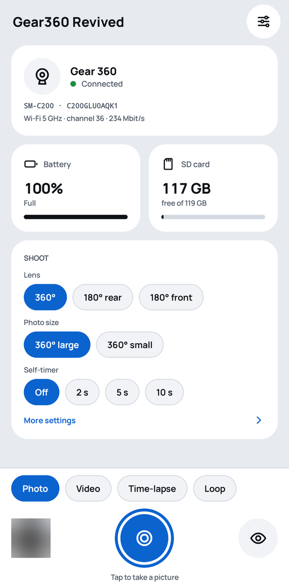
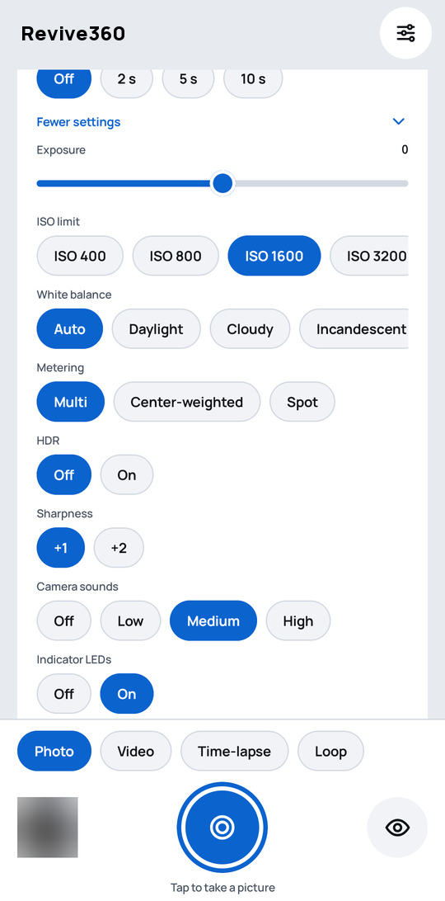
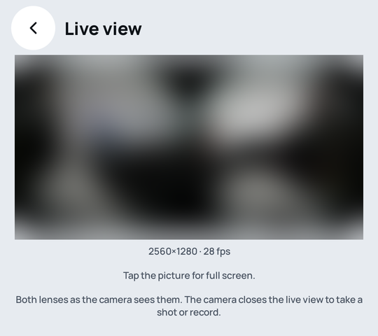
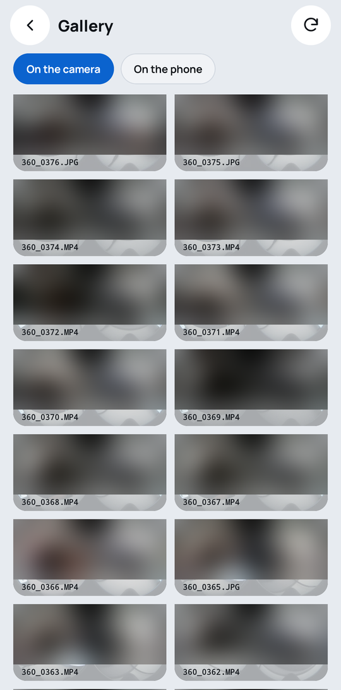
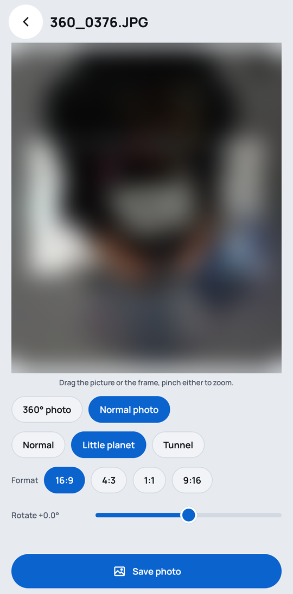

# Revive360 – for Gear 360

**Your Samsung Gear 360 works again: with any Android phone, free, and with no Samsung account.**

**Website:** [simoneluconi.github.io/Revive360](https://simoneluconi.github.io/Revive360/) · [Privacy policy](https://simoneluconi.github.io/Revive360/privacy/)

Samsung has stopped supporting the Gear 360 camera, and its apps no longer work on today's
phones, which leaves a good 360° camera unusable. Revive360 brings it back to life: a free
phone app plus a small add-on for the camera, and the camera does everything it used to.

<p align="center">
  
  
  
  
  
</p>

## In short

| | |
|---|---|
| **The problem** | Samsung's Gear 360 apps are gone. Without them you cannot see the camera's photos on your phone or use it from the phone. |
| **What this does** | Use the camera from your phone again: shoot, see live, change the settings, copy photos and videos, and get ready-made 360° photos. |
| **Who it is for** | Anyone with a Gear 360 (2016 or 2017) and an Android phone of any brand. |
| **What it costs** | Nothing. Free and open source, with no account, no cloud and no ads. |
| **Status** | Works today. Tested end to end, from setup to everyday use, on the Gear 360 (2016) and the Gear 360 (2017). |

## What you can do

- **Shoot from your phone**: photos, videos, time-lapses and looping videos.
- **See what the camera sees**, live, before you shoot.
- **Change the camera's settings**: lens, size, self-timer, exposure, white balance and more.
- **Get your photos and videos** onto the phone, or delete them from the camera, one or many at a time.
- **Get real 360° photos**, ready for Google Photos and other apps.
- **Shoot RAW**, which Samsung's own app never offered: the camera also keeps the sensor data of
  both lenses, and the app turns it into a DNG for Lightroom and other raw editors, one photo or
  many at once. 360° photos in good light; about 60 MB per photo. Gear 360 (2016) only for now.
- **Make normal photos from a 360° one**: look around, straighten it, choose the frame you want,
  or make a "little planet".

## Why it is easy to use

- **Any Android phone** (Android 10 or later): it does not have to be a Samsung.
- **Pairs by itself**: the phone finds the camera over Bluetooth and sets up the connection.
  There is nothing to type.
- **Private**: the phone talks straight to the camera. Nothing goes to the internet.
- **Saves the battery**: the camera's Wi-Fi is on only while the app needs it.
- **Can be undone**: one command puts Samsung's original software back on the camera.

## Which cameras

| Camera | Works? |
|---|---|
| Gear 360 (2016, SM-C200) with firmware C200GLU0AQK1 | Yes |
| Gear 360 (2016) with an older firmware | Yes, after updating it to C200GLU0AQK1 first |
| Gear 360 (2017, SM-R210) with firmware R210GLU0ARB2 | Yes (RAW not yet) |
| Gear 360 (2017) with an older firmware | Yes, after updating it to R210GLU0ARB2 first |

Only the last firmware Samsung released for each camera is supported. If your camera has an
older one, update it to the last one first: the [install guide](docs/INSTALL.md#what-you-need)
says how.

## How to get started

Setting it up takes about half an hour, once. You need the camera, its microSD card, an Android
phone and a computer.

1. **Get the app** from [Google Play](https://play.google.com/store/apps/details?id=com.simoneluconi.revive360), or download the APK from the
   [latest GitHub release](https://github.com/simoneluconi/Revive360/releases/latest).
2. **Set up the camera**: four commands on the computer do the work, and each one tells you
   what to do next on the camera:

```sh
./install.sh build      # prepare everything on the computer
./install.sh flash      # update the camera
./install.sh activate   # switch the update on
./install.sh sd         # get the camera ready, then pair it in the app
```

The step-by-step guide: **[docs/INSTALL.md](docs/INSTALL.md)**.

> Changing the camera's software is at your own risk. Samsung's original software can always be
> put back in the same way: the guide explains how.

## For developers

How it works, how to build it and how to add other cameras: [docs/DEVELOPMENT.md](docs/DEVELOPMENT.md).
How the RAW capture was found and what the files contain: [docs/firmware/14_raw_capture.md](docs/firmware/14_raw_capture.md);
scripts to make the DNGs on a computer instead: [tools/raw/](tools/raw/).
Contributions are welcome.

## License

Free software under the [GNU GPL v3](LICENSE). Revive360 is an independent project, not
made, affiliated with or endorsed by Samsung. Samsung and Gear 360 are trademarks of Samsung
Electronics; they are used here only to say which camera the app works with. It
contains no Samsung software: you download Samsung's original firmware yourself.

The app and the website use the [Manrope](https://github.com/googlefonts/manrope) font, under the
[SIL Open Font License 1.1](docs/manrope-OFL.txt).
